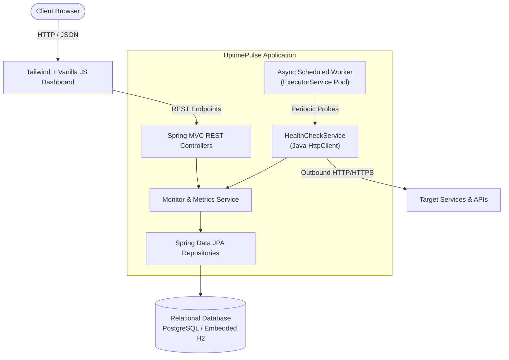
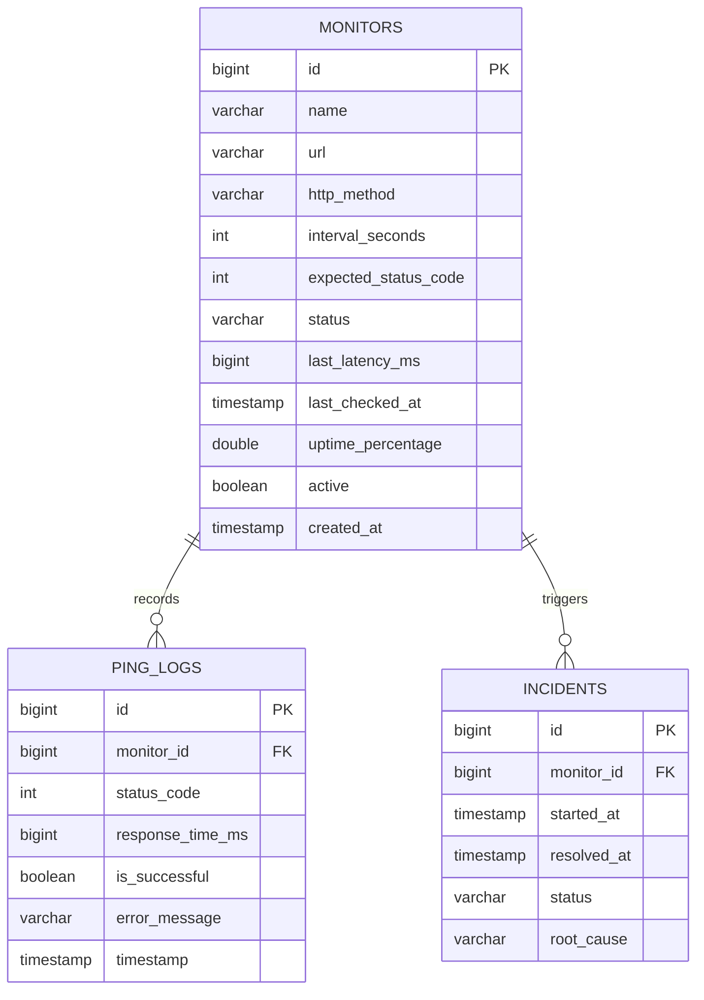

# UptimePulse

[](https://openjdk.org/)
[](https://spring.io/projects/spring-boot)
[](https://www.postgresql.org/)
[](https://www.docker.com/)
[](https://github.com/bharanit23/uptime-pulse/actions)

A lightweight, concurrent service availability and latency monitoring platform built with Java 21, Spring Boot 3, and relational persistence. It performs asynchronous HTTP health checks on configurable schedules, tracks response latency percentiles, manages incident lifecycles, and serves real-time status dashboards.

---

## Live Deployment

* **Production URL:** [https://uptime-pulse-kc57.onrender.com](https://uptime-pulse-kc57.onrender.com)
* **Public Status View:** [https://uptime-pulse-kc57.onrender.com/#public](https://uptime-pulse-kc57.onrender.com/#public)
* **API Endpoint:** [https://uptime-pulse-kc57.onrender.com/api/monitors](https://uptime-pulse-kc57.onrender.com/api/monitors)

---

## Overview & Architecture

UptimePulse is engineered as a standalone, low-overhead monitoring daemon designed to monitor critical HTTP endpoints, payment webhooks, and REST APIs. 

### Data Flow



---

## Core Capabilities

* **Non-Blocking Scheduled Probes:** Background polling jobs run on dedicated thread pools using Java's built-in `HttpClient`, avoiding worker thread starvation during slow downstream network calls.
* **Latency & SLA Aggregation:** Records millisecond response latencies and computes uptime SLA percentages over rolling windows.
* **Automated Incident Tracking:** Detects state transitions (`OPERATIONAL` ↔ `DEGRADED` ↔ `DOWN`). When an outage occurs, an incident record is logged with root cause details and automatically marked resolved when healthy responses resume.
* **Dual Persistence Strategy:** Native support for cloud PostgreSQL via standard JDBC configurations, with an automatic in-memory H2 fallback for zero-dependency local development and CI test runners.
* **Public Status Page:** Includes a read-only stakeholder view displaying service health and historical incident logs.

---

## Database Model



The `ping_logs` table includes a composite index on `(monitor_id, timestamp DESC)` to optimize time-series lookups and status graph queries.

---

## REST API Specification

| Method | Route | Description |
| :--- | :--- | :--- |
| `GET` | `/api/monitors` | List all registered monitors with recent log history |
| `GET` | `/api/monitors/{id}` | Fetch single monitor details and metrics |
| `POST` | `/api/monitors` | Register a new endpoint monitor |
| `PUT` | `/api/monitors/{id}` | Update endpoint target or check interval |
| `DELETE` | `/api/monitors/{id}` | Delete a monitor and its historical logs |
| `POST` | `/api/monitors/{id}/ping` | Trigger an immediate manual health check probe |
| `POST` | `/api/monitors/{id}/toggle` | Pause or resume background monitoring |
| `GET` | `/api/dashboard/stats` | Aggregated system health metrics |
| `GET` | `/api/dashboard/incidents` | Recent incident and outage logs |
| `GET` | `/api/status/public` | Unauthenticated public status payload |

---

## Local Development

### Requirements
* Java 21 or higher
* Git

### Build and Run

```bash
git clone https://github.com/bharanit23/uptime-pulse.git
cd uptime-pulse

# Run via Gradle wrapper
./gradlew bootRun
```

On Windows:
```powershell
.\gradlew.bat bootRun
```

The application starts on `http://localhost:8080`.

---

## Environment Configuration

Configuration properties can be set via standard environment variables:

| Variable | Default | Description |
| :--- | :--- | :--- |
| `PORT` | `8080` | HTTP port for the web server |
| `SPRING_DATASOURCE_URL` | `jdbc:h2:mem:uptimedb;...` | PostgreSQL or H2 JDBC connection string |
| `SPRING_DATASOURCE_USERNAME` | `sa` | Database user account |
| `SPRING_DATASOURCE_PASSWORD` | `""` | Database password |
| `SPRING_DATASOURCE_DRIVER` | `org.h2.Driver` | Driver class (`org.postgresql.Driver` for PostgreSQL) |

---

## Author

Developed by [Bharani](https://github.com/bharanit23).
